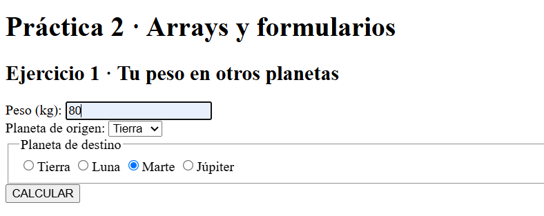
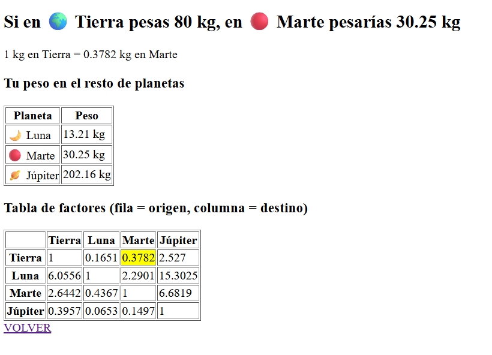
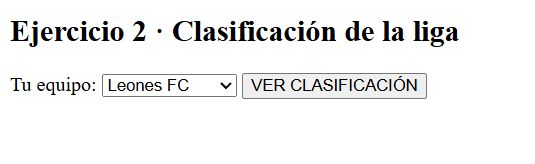
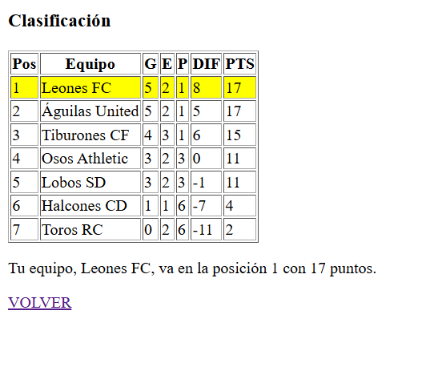

# Práctica 2 · Manejo de formularios y arrays (versión 5.2)

Recordad:

- `error_reporting(E_ALL);` para recoger errores.
- `ini_set("display_errors", 1);` para mostrar errores en el navegador.
- `sort()` ordena un array por valor de menor a mayor **reseteando las claves**.
- `rsort()` ordena un array por valor de mayor a menor **reseteando las claves**.
- `asort()` ordena un array por valor de menor a mayor **manteniendo las claves originales**.
- `arsort()` ordena un array por valor de mayor a menor **manteniendo las claves originales**.
- `ksort()` ordena un array por sus claves en orden ascendente; `krsort()`, en orden descendente.
- `isset()` comprueba si existe un valor para una clave.
- `is_numeric()` comprueba si un dato es un número (o un texto que contiene un número).
- `round($numero, $decimales)` redondea un número a los decimales indicados.
- `array_column($array, "campo")` devuelve un array simple con los valores de ese campo de cada fila de un array bidimensional.
- `array_multisort()` ordena un array bidimensional usando como criterios las columnas sacadas con `array_column`. El **último** parámetro es el array que se quiere ordenar. Por ejemplo, para ordenar unos productos por precio de mayor a menor y, si cuestan lo mismo, por nombre de la A a la Z:


La solución se entregará en el aula virtual como un fichero zip con el siguiente formato:

`nombre_apellido1_apellido2.zip`

| Ejercicio | Puntos |
|---|---|
| Ejercicio 1 · Tu peso en otros planetas | 6 |
| Ejercicio 2 · Clasificación de la liga | 4 |

## Ficheros (`practica2.html` y `soluciones.php`)

Los **dos formularios** están en el mismo fichero `practica2.html` y las **dos soluciones** en el mismo fichero `soluciones.php`. Ambos formularios usan el método **POST** y envían sus datos a `soluciones.php`.

Para que `soluciones.php` sepa qué formulario se ha enviado, cada formulario lleva un campo oculto:

```html
<input type="hidden" name="ejercicios" value="ej1">
```

En `soluciones.php`, cada ejercicio va dentro de su propio bloque:


La página no debe mostrar ningún *Warning* ni *Notice* por lo que deberás de ser capaz de controlar que el código PHP del ejercicio 1 no interfiera con el del ejercicio 2 y viceversa.

---

## Ejercicio 1 · Tu peso en otros planetas (6 puntos)

Lo que marca una báscula depende de la **gravedad** del sitio donde estés: en la Luna "pesarías" mucho menos que en la Tierra. Conocemos la gravedad de cada astro (en m/s²):

```php
$planetas = [
    "tierra"  => ["nombre" => "Tierra",  "icono" => "🌍", "gravedad" => 9.81],
    "luna"    => ["nombre" => "Luna",    "icono" => "🌙", "gravedad" => 1.62],
    "marte"   => ["nombre" => "Marte",   "icono" => "🔴", "gravedad" => 3.71],
    "jupiter" => ["nombre" => "Júpiter", "icono" => "🪐", "gravedad" => 24.79]
];
```

### Cálculo del factor

1. Por cuánto se multiplica el peso al pasar de un planeta a otro se calcula a partir de `$planetas`, con los planetas que llegan del formulario:
   ```
   factor = gravedad del destino / gravedad del origen
   ```
   Por ejemplo, de la Tierra a Marte: 3.71 / 9.81 = 0.3782. **No escribas ningún factor a mano.**

### Formulario (en `practica2.html`)

2. El formulario tiene:
   - Un campo de texto **peso** (en kg).
   - Un `<select>` con el **planeta de origen** (donde te has pesado).
   - Un grupo de **botones de opción** (`radio`) con el **planeta de destino**.
   - Un botón **CALCULAR**.

   El `value` de cada opción es la clave del planeta (`tierra`, `luna`…) y el texto muestra el icono y el nombre: *"🔴 Marte"*.

### Procesamiento (en `soluciones.php`)

3. Muestra el resultado redondeado a 2 decimales con la función `round($variable, nº de decimales)` y con los iconos, y el factor usado redondeado a 4 decimales:
   *"Si en 🌍 Tierra pesas 70 kg, en 🔴 Marte pesarías 26.47 kg"* · *"1 kg en Tierra = 0.3782 kg en Marte"*.
4. Además, muestra en una tabla lo que pesarías en **todos** los demás planetas.
5. Muestra la tabla de factores completa como tabla de doble entrada (filas = origen, columnas = destino), con dos `foreach` anidados sobre `$planetas` que calculan cada factor al pintar la celda, redondeado a 4 decimales. La celda del cálculo que se acaba de hacer va resaltada con otro color de fondo.

### Ejemplo con capturas

### CAPTURA 1


### CAPTURA 2


---

## Ejercicio 2 · Clasificación de la liga (4 puntos)

Tenemos los datos de una liga después de 8 jornadas. La clave de cada equipo es un código corto y cada fila guarda los partidos ganados, empatados y perdidos, y los goles a favor (`gf`) y en contra (`gc`):

```php
$equipos = [
    "leones"    => ["nombre" => "Leones FC",      "ganados" => 5, "empatados" => 2, "perdidos" => 1, "gf" => 15, "gc" => 7],
    "aguilas"   => ["nombre" => "Águilas United", "ganados" => 5, "empatados" => 2, "perdidos" => 1, "gf" => 13, "gc" => 8],
    "tiburones" => ["nombre" => "Tiburones CF",   "ganados" => 4, "empatados" => 3, "perdidos" => 1, "gf" => 12, "gc" => 6],
    "osos"      => ["nombre" => "Osos Athletic",  "ganados" => 3, "empatados" => 2, "perdidos" => 3, "gf" => 9,  "gc" => 9],
    "lobos"     => ["nombre" => "Lobos SD",       "ganados" => 3, "empatados" => 2, "perdidos" => 3, "gf" => 10, "gc" => 11],
    "halcones"  => ["nombre" => "Halcones CD",    "ganados" => 1, "empatados" => 1, "perdidos" => 6, "gf" => 7,  "gc" => 14],
    "toros"     => ["nombre" => "Toros RC",       "ganados" => 0, "empatados" => 2, "perdidos" => 6, "gf" => 6,  "gc" => 17]
];
```

Con un formulario se elige **tu equipo** y la página muestra la clasificación con tu equipo resaltado.

### Formulario (en `practica2.html`)

1. El formulario tiene:
   - Un `<select>` **equipo** con los siete equipos. El `value` de cada opción es la clave del equipo (`leones`, `aguilas`…) y el texto, su nombre.
   - Un botón **VER CLASIFICACIÓN**.

### Procesamiento (en `soluciones.php`)

2. Recorre `$equipos` y **añade a cada equipo dos campos nuevos** calculados a partir de sus datos:
   - `puntos` = 3 por partido ganado y 1 por partido empatado.
   - `dif` (diferencia de goles) = goles a favor − goles en contra.

   *CUIDAO!!!*: dentro de un `foreach`, la variable de cada fila es una **copia**. Para que los campos nuevos se guarden en `$equipos`, tienes que escribirlos con su clave: `$equipos[$clave]["puntos"] = ...`.
3. **Ordena** `$equipos` usando `array_column` y `array_multisort` con **dos criterios**:
   - Primero, por **puntos** de mayor a menor.
   - Si dos equipos tienen los mismos puntos, por **diferencia de goles** de mayor a menor.
4. Muestra la **clasificación** en una tabla HTML con las columnas **Pos**, **Equipo**, **G**, **E**, **P**, **DIF** y **PTS**. La fila del equipo elegido en el formulario va con otro color de fondo.
5. Debajo de la tabla, muestra la frase *"Tu equipo, Lobos SD, va en la posición 5 con 11 puntos"*.

### Ejemplo

Eligiendo **Lobos SD**:

| Pos | Equipo | G | E | P | DIF | PTS |
|---|---|---|---|---|---|---|
| 1 | Leones FC | 5 | 2 | 1 | 8 | 17 |
| 2 | Águilas United | 5 | 2 | 1 | 5 | 17 |
| 3 | Tiburones CF | 4 | 3 | 1 | 6 | 15 |
| 4 | Osos Athletic | 3 | 2 | 3 | 0 | 11 |
| 5 | Lobos SD *(resaltado)* | 3 | 2 | 3 | -1 | 11 |
| 6 | Halcones CD | 1 | 1 | 6 | -7 | 4 |
| 7 | Toros RC | 0 | 2 | 6 | -11 | 2 |

Tu equipo, Lobos SD, va en la posición 5 con 11 puntos.

Leones FC va por delante de Águilas United (y Osos Athletic por delante de Lobos SD) porque, con los mismos puntos, tiene más diferencia de goles.

### Ejemplo con capturas (eligiendo Leones FC)

### CAPTURA 1


### CAPTURA 2



Suerte chic@s :D
